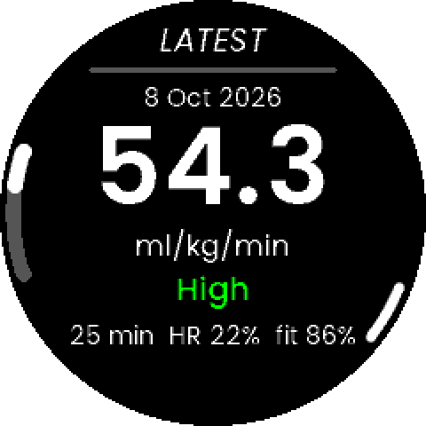
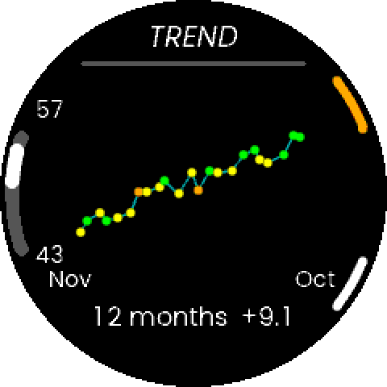
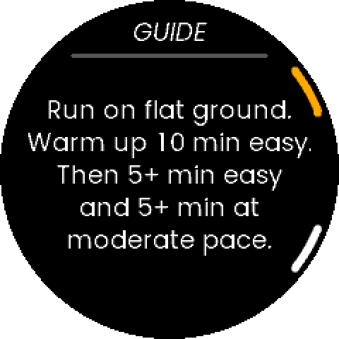

# VO2 max estimator

<p align="center">
  
  
  
</p>

## Setup

Requires [mise](https://mise.jdx.dev). Linux (Arch or Debian/Ubuntu).

```sh
mise trust
mise bootstrap   # OS packages, una-sdk clone, tools, LVGL submodule + Python venv
mise doctor      # optional health check
```

`UNA_SDK`, the ARM toolchain and the venv are automatically set inside this directory.

### Individual steps

```sh
mise bootstrap packages status   # which OS packages are missing
mise bootstrap packages apply    # install only the OS packages (asks for sudo)
mise bootstrap repos apply       # clone una-sdk at the pinned tag
mise install                     # ARM toolchain, cmake, ninja, node, uv
mise run bootstrap               # LVGL submodule + uv sync
```

`mise bootstrap` also applies any `[bootstrap]` sections in your global mise config.
To apply only this project's parts use: `mise bootstrap --only packages,repos,tools,task`.
Package declarations always merge with the global config.
To install strictly this project's packages, hide the global config:
`MISE_GLOBAL_CONFIG_FILE=$(mktemp --suffix .toml) mise bootstrap packages apply`.

## New app (run once for a new project)

Scaffold a new app from an **LVGL** example or tutorial in the SDK (TouchGFX is not supported)
([docs](https://www.developers.unawatch.com/latest/sdk-setup.html#creating-new-apps)):

```sh
mise run new-app MyApp --from una-sdk/Examples/Apps/RunLVGL
```

It ends by listing remaining instances of the example app name (display strings, window
title, comments) for you to review/edit by hand.

## Build and simulate

```sh
mise run build   # .uapp -> Output/
mise run sim     # build + run the Linux simulator (keys 1-4 = L1 L2 R1 R2, 5 = wrist, Esc = quit)
mise run sim --config simulator-configs/max-hr-190.json --history simulator-configs/vo2-history.json
mise run assets  # regenerate LVGL fonts/images
mise run icons   # regenerate the app icons
mise run screenshots  # simulator screenshots -> screenshots/
mise run test    # host unit tests (GoogleTest)
mise run clean
```

`--config` and `--history` copy sample files from `simulator-configs/` into the simulator's
file system (`Software/Output`); they stay there for later runs.

## Releasing

```sh
git tag apps-v0.1.0     # must match appVersion in Output/app-manifest.json
mise run package        # -> dist/VO2Max_0.1.0.zip
```

Upload the zip on the app's **Version** tab at https://apps.unawatch.com and release it
([docs](https://www.developers.unawatch.com/latest/deploy.html#sharing-the-apps)).

- Firmware build: https://www.developers.unawatch.com/latest/sdk-setup.html
- Linux simulator: https://www.developers.unawatch.com/latest/Tutorials/RunLVGL/ARCHITECTURE.html
